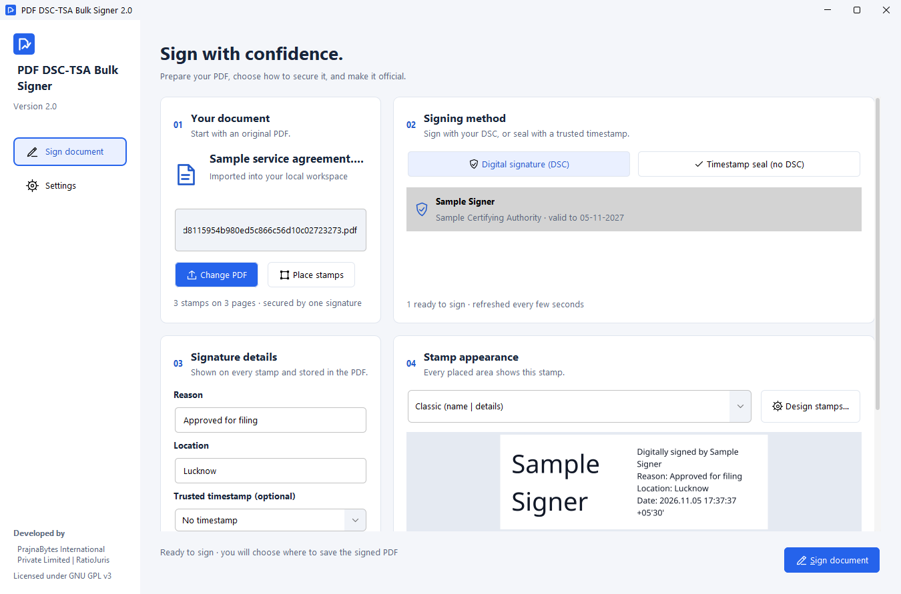
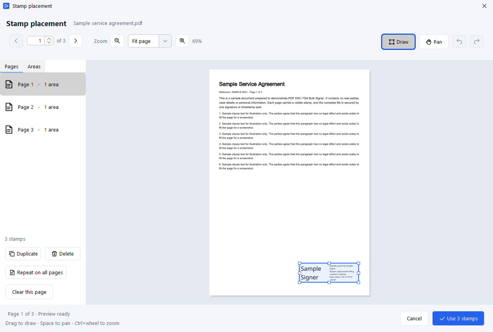
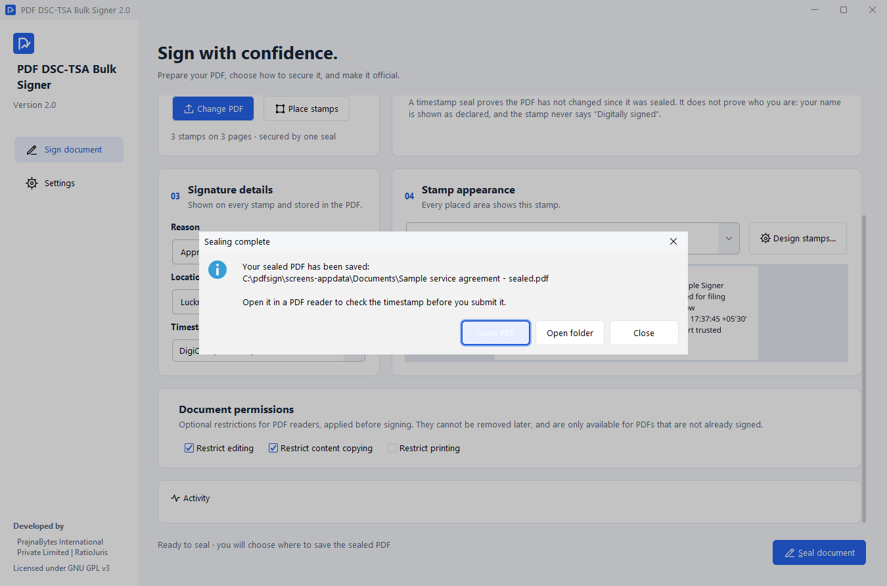
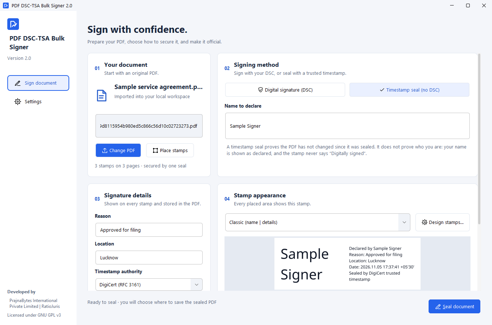
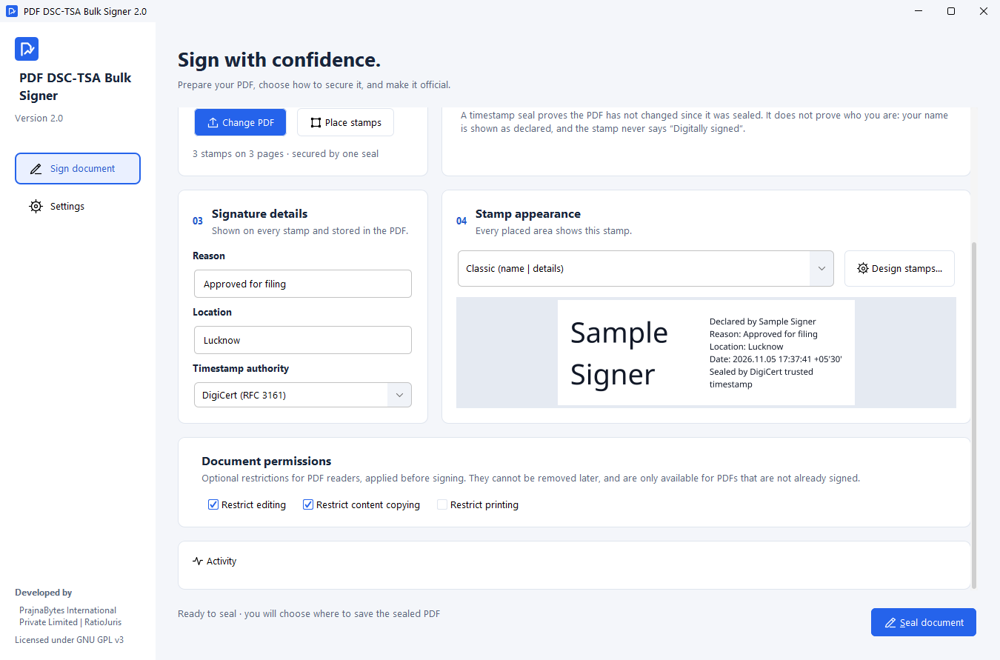
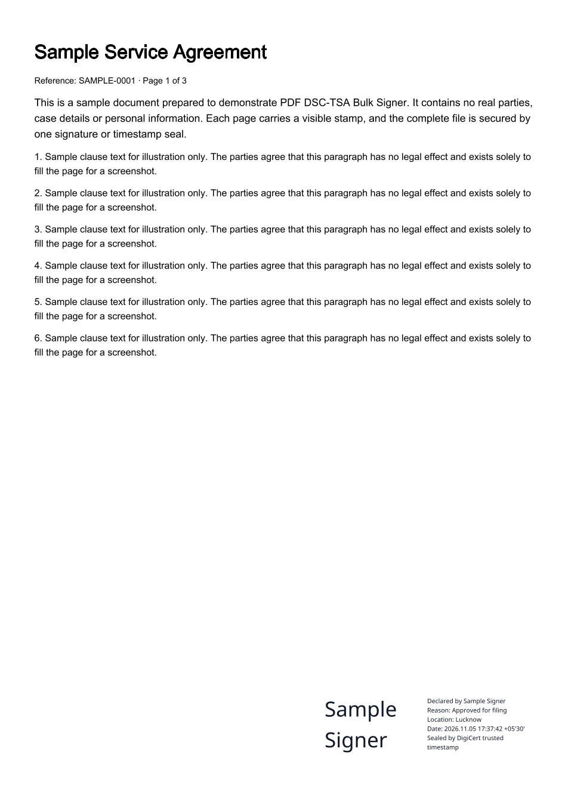
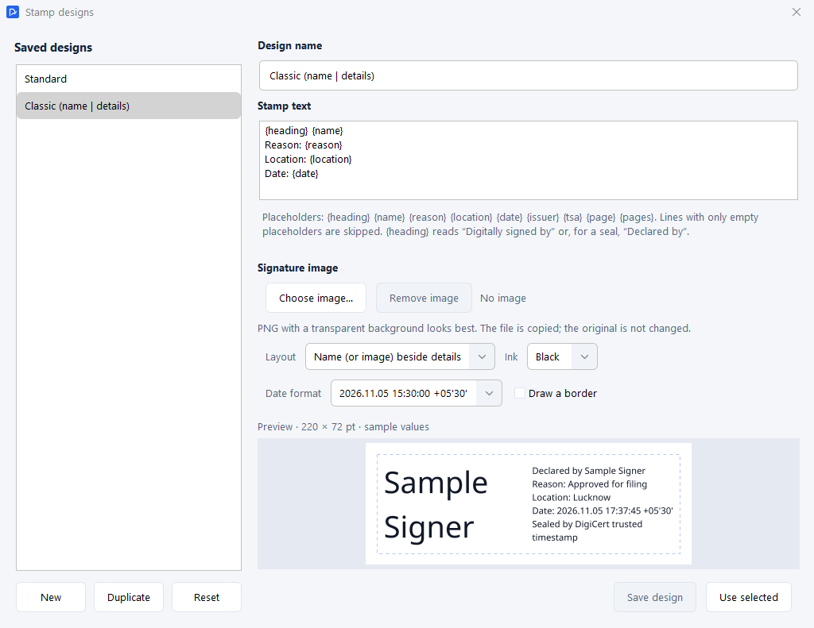
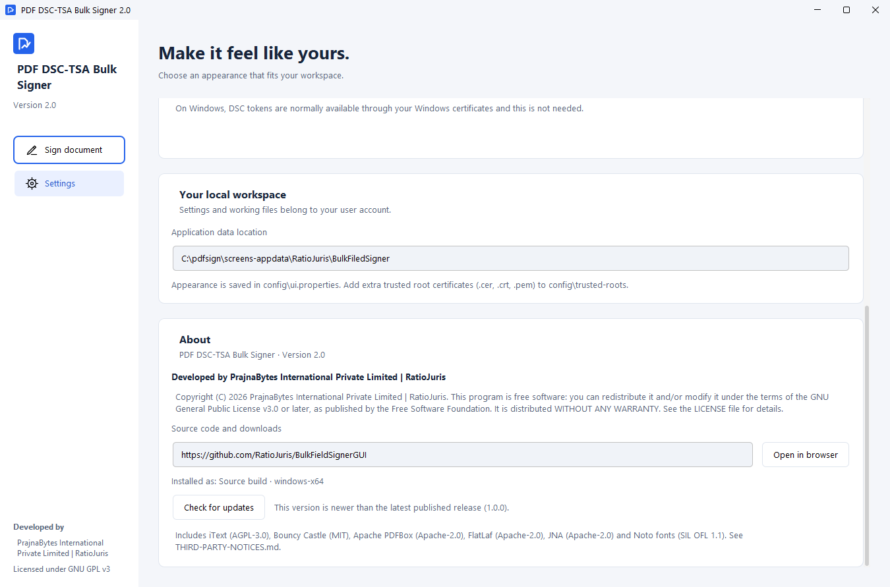

# PDF DSC-TSA Bulk Signer

**Version 2.0** · Developed by **PrajnaBytes International Private Limited | RatioJuris** · Free software (GNU GPL v3)

PDF DSC-TSA Bulk Signer is a desktop application for Windows that puts a visible signature stamp on
every page you choose in a PDF, and then digitally secures the whole document in one step.

It is made for advocates, legal professionals, offices and anyone who needs a signature mark on many
pages of a document: for example, every page of a petition, an affidavit or an agreement. Instead of
signing page by page, you place the stamps once (or place one and repeat it on every page) and sign
the whole file at the same time.

## Contents

- [Two ways to sign](#two-ways-to-sign)
- [What you can do](#what-you-can-do)
- [Download](#download)
- [Installation (Windows)](#installation-windows)
- [Signing your first document](#signing-your-first-document)
- [DSC and timestamp settings](#dsc-and-timestamp-settings)
- [Checking a signed document](#checking-a-signed-document)
- [Troubleshooting](#troubleshooting)
- [Security and important information](#security-and-important-information)
- [Frequently asked questions](#frequently-asked-questions)
- [Screenshots](#screenshots)
- [Support and bug reports](#support-and-bug-reports)
- [License and credits](#license-and-credits)

## Two ways to sign

The application has two signing methods. You choose one in the **Signing method** section of the
main window.

| | **Digital signature (DSC)** | **Timestamp seal (no DSC)** |
| --- | --- | --- |
| What you need | Your Digital Signature Certificate, usually on a USB token | An internet connection and your name |
| What the stamp says | "Digitally signed by *the name on your certificate*" | "Declared by *the name you type*" and "Sealed by *the timestamp service* trusted timestamp" |
| What it proves | **Who** signed the document, and that it has not been changed since | Only that the document has **not been changed** since it was sealed |

**What is a DSC?** A Digital Signature Certificate is an electronic identity issued to you by a
licensed certifying authority, usually stored on a USB token protected by a PIN. Signing with it
links the document to you.

**What is a TSA?** A Time Stamping Authority is an independent online service (such as DigiCert or
Sectigo) that confirms the exact time a document existed in its current form. You can add a trusted
timestamp to a DSC signature, or use the **Timestamp seal** on its own when you do not have a DSC.

> A timestamp seal is **not** a digital signature. It does not prove who you are. The stamp always says
> "Declared by", never "Digitally signed".

## What you can do

- **Open one PDF and place signature stamps** on the pages you choose. Draw a box where the stamp
  should go, then use **Repeat on all pages** to add it to every page in the same position.
- **Sign the whole document at once** with your DSC (one PIN entry), or seal it with a trusted timestamp.
- **Add a trusted timestamp** from DigiCert, Sectigo, GlobalSign, SSL.com or Entrust.
- **Choose how the stamp looks**:
  - *Standard* (text in a box) or *Classic* (your name on the left, details on the right).
  - Your own designs, optionally with an image of your handwritten signature.
  - Hindi (Devanagari) text is supported.
- **Add the reason and location**, which are shown on every stamp and stored in the signed file.
- **Optionally restrict** editing, copying or printing of the signed PDF.
- **Keep your original safe.** The application works on a copy. When signing finishes, it asks where to
  save the signed PDF, under a new name.
- **Follow the progress.** The **Activity** panel at the bottom of the main window shows each step
  and any error.
- **Receive updates.** The application checks for new versions and tells you when one is available.

The application signs **one PDF at a time**. Each PDF can carry stamps on as many pages as you need.

## Download

Download version 2.0 from the
[Releases page](https://github.com/RatioJuris/BulkFieldSignerGUI/releases). For Windows, choose one of:

| File | What it is |
| --- | --- |
| `PDF-DSC-TSA-Bulk-Signer-2.0.0-windows-x64-portable.zip` | **Portable version.** No installation needed. |
| `PDF-DSC-TSA-Bulk-Signer-2.0.0-windows-x64.msi` | **Installer.** Installs for all users of the computer and adds the application to the Start menu and desktop. |
| `SHA256SUMS.txt` | Checksums to confirm your download is complete and unaltered. |

The older version 1.0 (named "BulkFieldSignerGUI") is still available on the Releases page.

The Releases page also has packages for Linux and macOS; see [`docs/INSTALL.md`](docs/INSTALL.md).

Everything the application needs, including Java, is included in the download. You do **not** need
to install Java or anything else.

## Installation (Windows)

You need **64-bit Windows 10 or Windows 11**. The application has been tested on Windows 11.
- The **installer** needs administrator approval once: Windows asks "Do you want to allow this app to
  make changes to your device?". Click **Yes**.
- The **portable version** needs no administrator rights.

### Option 1: Portable version (no installation)

1. Download the `…-windows-x64-portable.zip` file.
2. Right-click the file and choose **Extract All…**. Choose a folder you can write to, for example
   `Documents` or a USB drive.
3. Open the extracted folder **PDF DSC-TSA Bulk Signer 2.0.0**.
4. Double-click **bulksigner.exe**.

Do not run the program from inside the ZIP file; extract it first.

Your settings are **not** kept in the program folder; they are kept in your Windows user profile. This
means:
- You can move or delete the program folder without losing your settings.
- To take your settings to another computer, copy the folder
  `%LOCALAPPDATA%\RatioJuris\BulkFiledSigner\config` to the same place on that computer.

### Option 2: Installer (MSI)

1. Download the `…-windows-x64.msi` file.
2. Double-click it and follow the installer. When Windows asks for permission, click **Yes**.
3. Start the application from the **Start menu** or the **desktop shortcut**: **PDF DSC-TSA Bulk Signer**.

The program is installed in `C:\Program Files\RatioJuris\BulkFieldSignerGUI` (the program file is
`bulksigner.exe`).

**To uninstall:** open **Settings → Apps → Installed apps**, find **PDF DSC-TSA Bulk Signer**, and
choose **Uninstall**. Your settings and signed documents are kept.

**If you have version 1.0 installed:** the 2.0 installer removes it automatically and installs 2.0.

### Windows security warning

Windows may show **"Windows protected your PC"** the first time you open the program, because it is
a new download. Click **More info**, then **Run anyway**, if you downloaded it from the official
Releases page.

## Signing your first document

1. **Start the application.** The main window opens with four numbered sections.
2. **Import your PDF.** In **01 Your document**, click **Import PDF** (or press Ctrl+O) and choose the
   file. The application works on a copy; your original is only read.
3. **Choose the signing method.** In **02 Signing method**:
   - **Digital signature (DSC):** insert your DSC token and select your certificate in the list.
   - **Timestamp seal (no DSC):** type the name to declare.
4. **Fill in the details.** In **03 Signature details**, enter the **Reason** and **Location**.
   Optionally choose a **Trusted timestamp** (required for a timestamp seal).
5. **Choose the stamp design.** In **04 Stamp appearance**, pick a design. The preview shows exactly
   how each stamp will look. Click **Design stamps…** to create your own.
6. **Place the stamps.** Click **Place stamps**.
   - In the window that opens, drag a box on the page where the stamp should appear.
   - To use the same position on every page, select the box and click **Repeat on all pages**.
   - Check the pages, then click **Use … stamps**.
   
7. **Optional: permissions.** Under **Document permissions**, tick any restrictions you want
   (editing, copying, printing). These cannot be removed later.
8. **Sign.** Click **Sign document** (or **Seal document**). If you use a DSC token, its software asks
   for your PIN.
9. **Choose where to save.** When signing finishes, a **Save** window opens.
   - It starts in the folder your original PDF came from, with a suggested name such as
     "Agreement - signed.pdf".
   - Choose a folder and click **Save**. The application will not let you overwrite your original PDF.
   - Then click **Open PDF** to view the result, or **Open folder** to see where it is.
   
10. **Check the signed PDF** in a PDF reader (see [Checking a signed document](#checking-a-signed-document)).

## DSC and timestamp settings

### Selecting your certificate

Insert your DSC USB token. Your certificates appear in **02 Signing method**, usually within a few
seconds; the list refreshes automatically. Select the certificate you want to sign with.

- **Certificates you can't select.** A certificate shown in grey can't be used right now, and the
  reason is shown under its name:
  - "Certificate expired on …": renew it with your certifying authority.
  - "DSC token not connected": plug in the token.
- **Certificates you won't see.** Only personal signing certificates are listed. Certificates that
  Windows creates for its own use are hidden.

**Before signing, have ready:**
- your DSC token and its PIN;
- the reason and place of signing;
- an internet connection, if you want a timestamp.

### Using a timestamp

- **With a DSC:** choosing a **Trusted timestamp** is optional. It adds an independent confirmation of
  the signing time.
- **With a timestamp seal:** a **Timestamp authority** is required.
- **Which service to use:** any of the listed services works. If one does not respond, choose another.
  Timestamps need an internet connection.

### Linux and macOS

On Linux and macOS, DSC tokens are set up in **Settings → DSC token**. See
[`docs/INSTALL.md`](docs/INSTALL.md).

## Checking a signed document

**Signing** creates the signature. **Verifying** checks it. Always verify important documents with a
PDF reader such as Adobe Acrobat Reader:

1. Open the signed PDF.
2. Open the **Signature panel**: the blue bar at the top, or **View → Show/Hide → Signatures**.
3. Check that the signature is valid, shows the right signer and time, and that the document has not
   been modified since it was signed.

The visible stamps on the pages are marks for the reader. The proof is the digital signature or
timestamp shown in the Signature panel. Whether the reader shows a signature as "trusted" can depend
on the reader's own settings for your certifying authority.

## Troubleshooting

| Problem | What to do |
| --- | --- |
| **The application does not start** | Make sure the ZIP was fully extracted (not opened from inside the ZIP). If Windows shows "Windows protected your PC", choose **More info → Run anyway**. If it still does not start, report it (see [Support](#support-and-bug-reports)) and attach the file `%LOCALAPPDATA%\RatioJuris\BulkFiledSigner\logs\application.log`. |
| **A PDF cannot be opened** | Password-protected PDFs, files larger than 256 MB and documents with more than 10,000 pages are not supported. Remove the password in the program that created the PDF, or split very large files. |
| **My DSC does not appear** | Plug in the token and wait a few seconds. Install the token driver from your certifying authority. Check that the certificate appears in Windows (search the Start menu for "Manage user certificates", then look under **Personal → Certificates**). If it appears in grey in the application, read the reason shown under it. |
| **PIN or certificate login fails** | Enter the PIN carefully; tokens lock after several wrong attempts, and only your certifying authority can unlock them. If the PIN window does not appear, reconnect the token and try again. |
| **The timestamp service is unavailable** | Check your internet connection and try another service in the timestamp list. In DSC mode you can choose **No timestamp** and sign without one. |
| **A PDF cannot be signed** | The **Activity** panel shows the reason. PDFs that are certified, password-protected or carry restricted signatures cannot be signed. Permissions cannot be added to a PDF that is already signed. |
| **One document fails but others succeed** | Each document is signed separately, so a failure does not affect your other documents. Open the **Activity** panel for that document's reason and see the rows above. |
| **The signed file cannot be saved** | The application tells you why and lets you choose another folder. Pick a folder you can write to, such as **Documents**, and check that the disk is not full. Some folders, such as `C:\Program Files`, cannot be written to. |
| **An update fails** | Click **Retry** in the update window and check your internet connection. Portable copies need a folder you can write to. If a **critical update** is required, signing stays paused until it is installed; you can also download the new version from the Releases page. |

## Security and important information

- **Protect your DSC.** Never share your token or PIN. Remove the token when you are not signing.
- **Verify your documents.** Check signed PDFs in a PDF reader before you submit them.
- **Keep your originals.** The application never changes your original PDF; keep it where appropriate.
- **Review the output.** Open each signed file and check the stamps, pages and details.
- **What a signature does not prove.** A digital signature shows who signed and that the file has not
  changed. It does not make the document's content correct or legally valid. Whether a particular
  office accepts a DSC signature or a timestamp seal is decided by that office.
- **Your documents stay on your computer.** They are never uploaded. When you use a timestamp, only a
  digital fingerprint of the document is sent to the timestamp service.
- **Updates are checked before installation.** The application installs only updates signed by the
  developer and confirmed with a checksum.

## Frequently asked questions

**Do I need to install Java?** No. Everything needed is included in the download.

**Does it work without the internet?** Yes, for signing with a DSC without a timestamp. Timestamps,
timestamp seals and update checks need the internet.

**Is my original PDF changed?** No. The application signs a copy and saves the result as a new file.

**Where are my signed files?** Wherever you chose in the
**Save** window. If you cancelled that window, the application tells you where it kept a copy and lets
you **Save As…** again. All signed copies are also kept in
`%LOCALAPPDATA%\RatioJuris\BulkFiledSigner\output`, in a new folder for each signing.

**Can I sign several PDF files at once?** The application signs one PDF at a time, but places stamps
on as many pages of that PDF as you need, and signs them all with one PIN entry.

**What is the difference between "Signed" and "Sealed"?** "Signed" uses your DSC and proves who you
are. "Sealed" uses only a trusted timestamp and proves that the document has not changed.

**Why is a newer version required before I can sign?** A critical or security update was published.
Signing is paused until it is installed, to protect your documents.

## Screenshots

These screenshots come from the real application, using a sample document and a sample certificate.

| | |
| --- | --- |
|  **Main window:** signing with a DSC |  **Timestamp seal:** no DSC needed |
|  **Placing stamps** on the pages |  **Details, stamp appearance and permissions** |
|  **Saved:** open the PDF or its folder |  **Result:** a page of the sealed sample |
|  **Stamp designer** with live preview |  **Settings → About** and update check |

## Support and bug reports

- **Downloads and releases:** <https://github.com/RatioJuris/BulkFieldSignerGUI/releases>
- **Report a problem or request a feature:** <https://github.com/RatioJuris/BulkFieldSignerGUI/issues>.
  Describe what you did and what happened, and attach `application.log` if possible. **Never attach
  confidential documents, certificates or PINs.**
- **Installation on Linux and macOS:** [`docs/INSTALL.md`](docs/INSTALL.md)
- **For developers and contributors:** [`CONTRIBUTORS.md`](CONTRIBUTORS.md)
- **Source code:** <https://github.com/RatioJuris/BulkFieldSignerGUI>

## License and credits

PDF DSC-TSA Bulk Signer is free software, licensed under the
**GNU General Public License v3.0 or later**. See [`LICENSE`](LICENSE). It includes third-party
components under their own licenses; see [`THIRD-PARTY-NOTICES.md`](THIRD-PARTY-NOTICES.md).

Developed by **PrajnaBytes International Private Limited | RatioJuris**.
