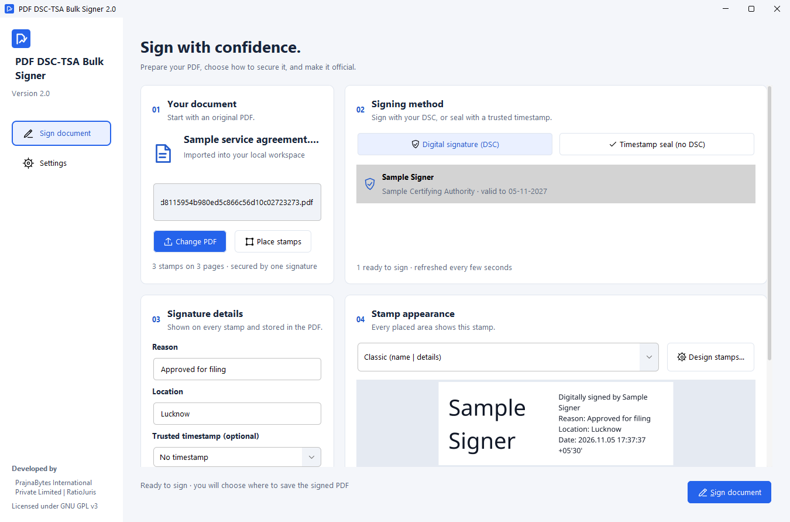
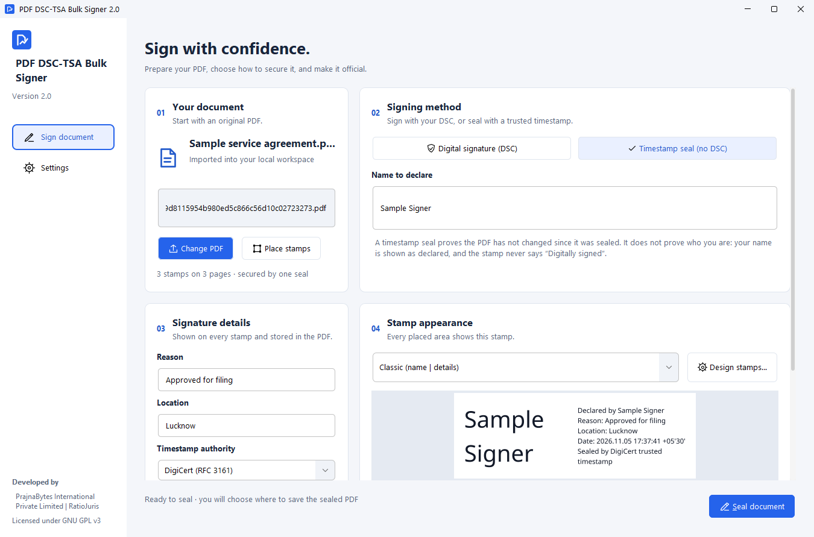
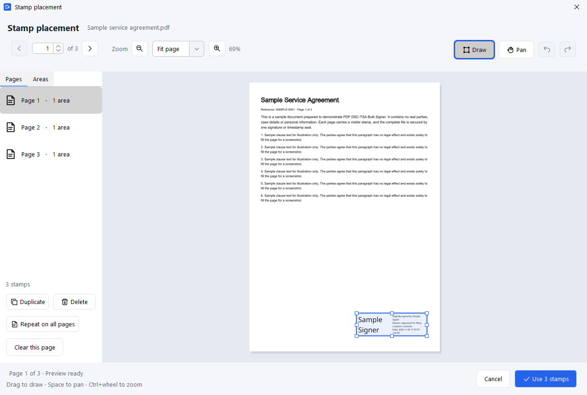
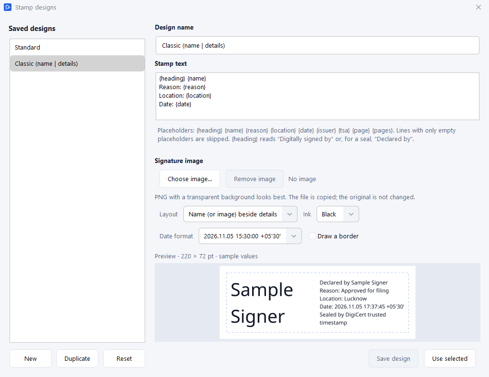
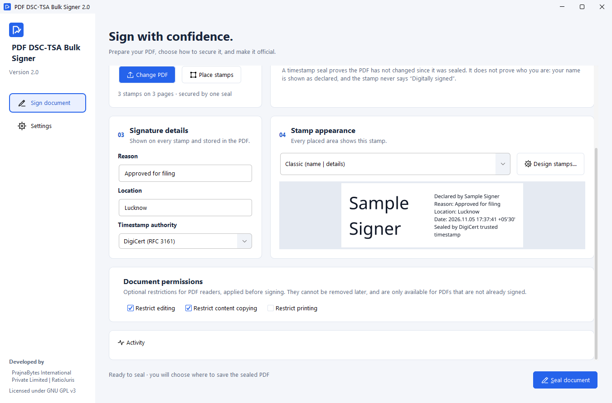
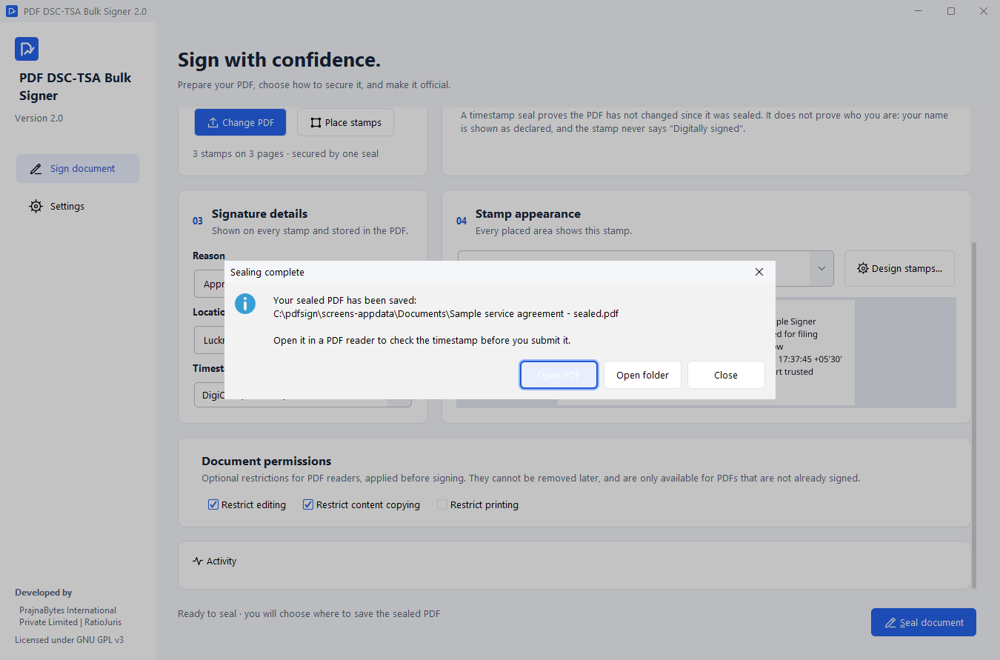
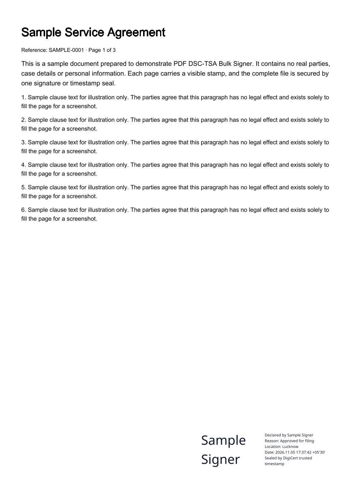
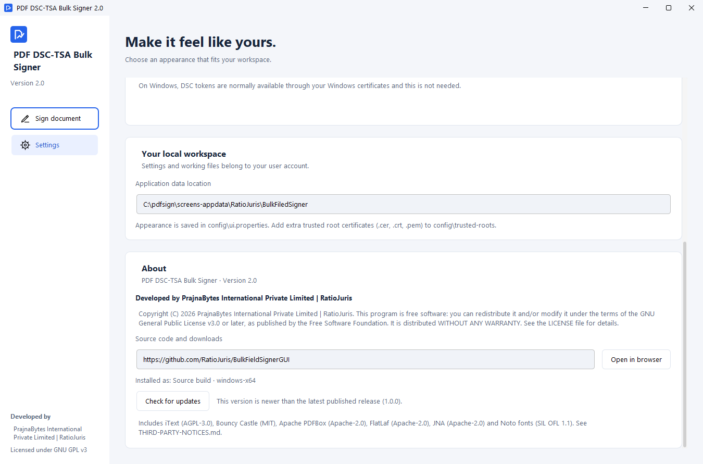

# PDF DSC-TSA Bulk Signer 2.0

**Visible stamps on every page. One signature or timestamp seal for the whole document.**

Developed by **PrajnaBytes International Private Limited | RatioJuris** ·
Licensed under the **GNU General Public License v3.0 or later** ·
Source: <https://github.com/RatioJuris/BulkFieldSignerGUI>

## Overview

PDF DSC-TSA Bulk Signer is a Windows desktop application for advocates, firms,
offices and other professionals who need a visible signature mark on many
pages of a PDF.

You choose where a stamp should appear on each page, pick how the document is
secured, and the application does the rest:

* every chosen page receives a **visible stamp** showing the signer, reason,
  place and date;
* the complete file, stamps included, is then secured by **one** cryptographic
  operation, either a **Digital Signature Certificate (DSC)** signature or an
  **RFC 3161 timestamp seal**;
* the signature or seal is verified before the signed copy is saved, and the
  original PDF is never changed.

## Key capabilities

### Two ways to secure a document

| | Digital signature (DSC) | Timestamp seal (no DSC) |
| --- | --- | --- |
| Needs | A DSC in your Windows account, for example on a USB token | A name to declare and an internet connection |
| Secures the PDF with | One invisible signature from your certificate, optionally with a trusted timestamp | One RFC 3161 document timestamp |
| Stamp wording | "Digitally signed by *certificate name*" | "Declared by *your name*" and "Sealed by *authority* trusted timestamp" |
| Proves | Who signed, and that the document has not changed | That the document has not changed since sealing |

A timestamp seal never claims to be a personal signature: the declared name is
shown as declared, and no certificate verifies it.

### Stamps where you need them

* Draw stamp areas directly on a page preview, then move or resize them, with
  undo and redo.
* **Repeat on all pages** copies a stamp to every page and keeps it at the same
  edge, so a bottom-right stamp stays bottom-right even on pages of other sizes
  or orientations.
* Zoom from 25% to 400%, pan, and page through documents of up to 10,000 pages.
* Each box in the editor shows the actual stamp, not a placeholder.

### Stamp designs

* Two built-in designs: **Standard** (bordered text) and **Classic (name | details)**,
  the familiar two-column look with the signer's name large on the left and the
  details on the right.
* Create your own designs with a text template and placeholders for name,
  reason, location, date, certificate issuer, timestamp authority and page
  numbers.
* Add your own signature image (PNG, JPEG, GIF or BMP), choose the ink colour,
  border and date format (`05-11-2026 15:30:00 +05:30` or
  `2026.11.05 15:30:00 +05'30'`).
* Hindi and other Devanagari text is shaped correctly on stamps.

### Trusted timestamps

Choose DigiCert, Sectigo, GlobalSign, SSL.com or Entrust. Every timestamp
response is checked before use: request nonce and document fingerprint,
the authority's signature, its timestamping certificate, and its certificate
chain to a root trusted by Windows.

### Document permissions

For PDFs that are not already signed, you can restrict editing, content copying
and printing before the document is secured. These restrictions are enforced by
PDF reader software and cannot be removed afterwards.

### A clear certificate list

Only personal document-signing certificates are listed. Windows device keys and
work or school account certificates are hidden. A genuine DSC that has expired,
or whose USB token is not plugged in, is shown greyed out with the reason, and
becomes available within seconds of inserting the token.

## How it works

1. **Import a PDF.** The application copies it into its own workspace; your
   original file is only read.
2. **Choose the signing method:** your DSC, or a timestamp seal with a declared
   name.
3. **Add details:** reason, location and, optionally, a timestamp authority.
4. **Place stamps** on the pages you need, or place one and repeat it on all
   pages.
5. **Pick a stamp design**, or create your own.
6. **Sign or seal.** The application stamps the pages, secures the file once,
   verifies the result, and asks where to save the signed PDF, starting in your original's folder.
   You can then open the saved PDF or its folder directly.

The sealed sample document, with its stamp:

## System requirements

* **Operating system:** Windows, 64-bit (x64). Built and tested on Windows 11 Pro
  (version 10.0.22631). Other Windows versions: TODO (not yet verified).
* **Installation:** the installer installs for all users in
  `C:\Program Files\RatioJuris\BulkFieldSignerGUI` and asks for administrator
  approval once. The portable version needs no installation and no
  administrator rights. No Windows service or system certificate-store changes
  are made.
* **Linux and macOS:** packages for Linux (x64, arm64) and macOS (Apple
  silicon, Intel) are built, installed and started by automated tests. Signing
  with a real DSC token on Linux or macOS has not been verified.
* **Runtime:** included in every download (Microsoft Build of OpenJDK 25);
  nothing else needs to be installed.
* **For DSC signing:** a Digital Signature Certificate available in your Windows
  account, for example through your USB token's driver. Tested with a real
  HyperPKI HYP2003 USB token and a Verasys-issued DSC on Windows 11, with and
  without a DigiCert timestamp; the token's own PIN window is used.
* **For timestamp seals and optional signature timestamps:** an internet
  connection.
* **Limits:** PDFs up to 256 MiB and 10,000 pages; up to 10,000 stamps per
  document.
* **Disk space:** about 90 MB for the application (Windows portable version,
  including its Java runtime), plus space for your signed PDFs.
* **Memory:** about 180 MB when the application is open and idle (measured on
  Windows 11). Large PDFs need more; the requirement for the largest supported
  documents has not been measured.

## Security and signing notes

* All work happens on your computer, in your own Windows profile. Documents
  are not uploaded anywhere; only the document fingerprint is sent to a
  timestamp authority when you use one.
* The source PDF is never modified. Signed copies are written to a new folder
  only after the signature or seal has been verified.
* The signature format is a CMS (PKCS #7) detached signature. Certificate
  validity, key usage and the certificate chain to a Windows-trusted root are
  checked, but **online revocation status (OCSP/CRL) is not checked**, and the
  output is not PAdES long-term-validation (LTV) enabled.
* Already-signed PDFs are updated incrementally, so earlier signatures remain
  valid. Certified PDFs, PDFs with signature transform restrictions and
  encrypted PDFs are rejected rather than rewritten.
* Stamp text is drawn as vector shapes, so it is not searchable or selectable
  in the PDF.
* Your DSC token software may ask for its PIN; this is not a Windows
  administrator prompt.
* Whether a particular authority accepts a DSC-signed or timestamp-sealed
  document is decided by that authority.

## License

PDF DSC-TSA Bulk Signer is free software, licensed under the
**GNU General Public License v3.0 or later**. You may use, study, share and
modify it under the terms of that license. It includes third-party components
under their own licenses, including iText (AGPL-3.0), Bouncy Castle (MIT),
Apache PDFBox (Apache-2.0), FlatLaf (Apache-2.0), JNA (Apache-2.0) and the Noto
fonts (SIL Open Font License 1.1). See `LICENSE` and `THIRD-PARTY-NOTICES.md` in
the repository.

## Developer

Developed by **PrajnaBytes International Private Limited | RatioJuris**.

## Source code and download

* **Source code:** <https://github.com/RatioJuris/BulkFieldSignerGUI>
* **Download:** <https://github.com/RatioJuris/BulkFieldSignerGUI/releases/tag/v2.0.0>.
  For Windows, choose the installer (`.msi`, installs for all users and
  replaces version 1.0) or the portable `.zip`. Packages for Linux (`.deb`,
  `.tar.gz`) and macOS (`.dmg`) are also attached; see the system requirements
  for their status.

### Open and verifiable

PDF DSC-TSA Bulk Signer is independent open-source software. Its complete
source code is public, and every release lists SHA-256 checksums
(`SHA256SUMS.txt`) so you can confirm that your download is genuine.

Commercial code-signing certificates are a recurring paid service that this
project does not currently use. The first time you open the application,
Windows or macOS may therefore show a security notice for an unrecognised
publisher:

* **Windows:** if you see "Windows protected your PC", click **More info**,
  then **Run anyway**.
* **macOS:** try to open the application once, then open **System Settings →
  Privacy & Security**, click **Open Anyway** next to the message about PDF
  DSC-TSA Bulk Signer, and confirm. On macOS 14 and older, you can instead
  right-click the application and choose **Open**.

## Get started

[Download PDF DSC-TSA Bulk Signer 2.0](https://github.com/RatioJuris/BulkFieldSignerGUI/releases/tag/v2.0.0)
for your computer, open your PDF, and start stamping and signing your documents.

## Screenshot index

| File | Shows |
| --- | --- |
| [`01-main-window.png`](../../screenshots/prajnabytes/01-main-window.png) | Main window in DSC mode with a sample certificate, three stamps placed and the Classic stamp design |
| [`02-signing-mode.png`](../../screenshots/prajnabytes/02-signing-mode.png) | Timestamp seal mode with a declared name and the DigiCert authority |
| [`03-signature-fields.png`](../../screenshots/prajnabytes/03-signature-fields.png) | Stamp placement editor showing the actual stamp on page 1 |
| [`04-security-options.png`](../../screenshots/prajnabytes/04-security-options.png) | Signature details, stamp appearance and document permissions |
| [`05-completed-signing.png`](../../screenshots/prajnabytes/05-completed-signing.png) | Confirmation after a real DigiCert timestamp seal |
| [`06-sealed-output.png`](../../screenshots/prajnabytes/06-sealed-output.png) | Page 1 of the sealed sample document with its stamp |
| [`07-stamp-designer.png`](../../screenshots/prajnabytes/07-stamp-designer.png) | Stamp designer with the Classic design and live preview |
| [`08-about.png`](../../screenshots/prajnabytes/08-about.png) | Settings → About with version, developer, license and source link |

All screenshots were captured from the running version 2.0 application using a
generated sample document and a generated sample certificate. They contain no
real personal or case information.
